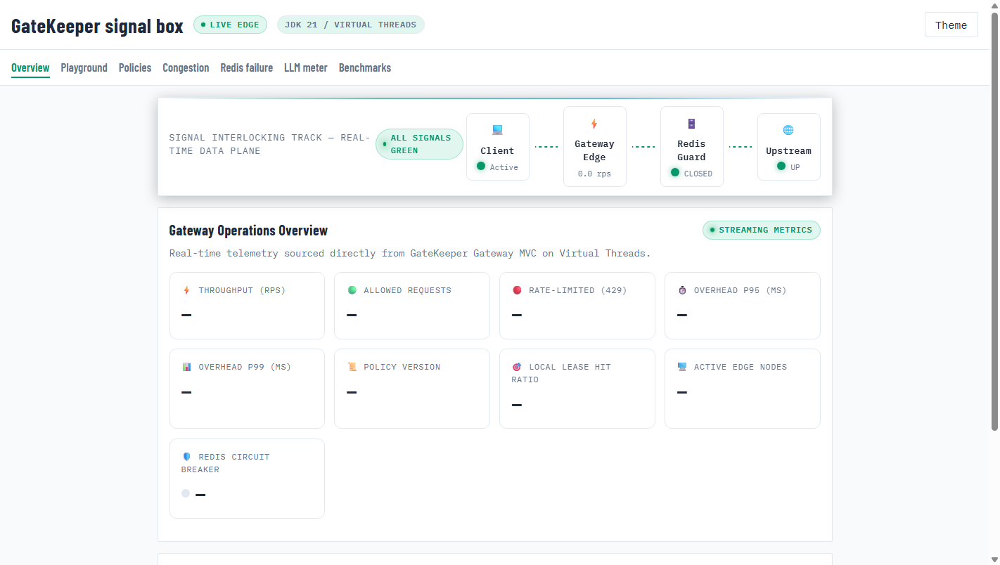
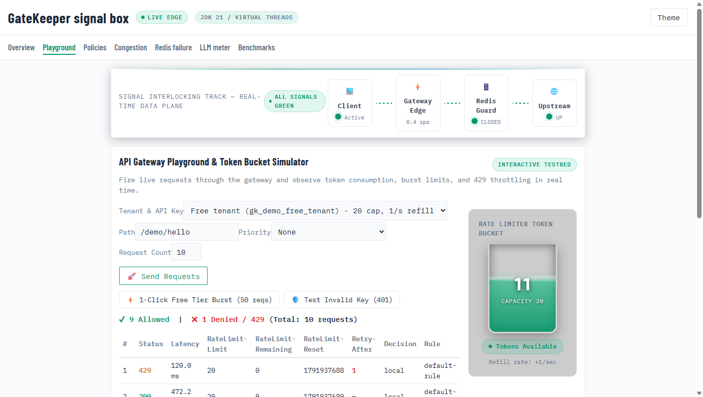

# 🛡️ GateKeeper

> **Ultra-low latency, distributed API Rate Limiter & Edge Gateway with Java 21 Virtual Threads, Redis Token Leasing, and Google CEL Policy Hot-Reloading.**

[](https://adoptium.net/)
[](https://spring.io/projects/spring-boot)
[](https://spring.io/projects/spring-cloud-gateway)
[](https://redis.io/)
[](https://www.docker.com/)
[-blue.svg)](AUDIT.md)
[](LICENSE)

---

## 📸 Real Project Screenshots

### 1. Real-Time Operations Console & Signal Interlocking Track
*Live telemetry dashboard showing active edge nodes, circuit breaker health, and end-to-end signal tracking:*


### 2. Interactive Token Bucket Simulator & Live Request Throttling
*Live token bucket physical simulation with 429 burst throttling and RFC rate-limit response headers:*


---

## 📑 Table of Contents

- [About](#about)
- [Key Features](#key-features)
- [Architecture](#architecture)
- [Demo Screenshots](#demo-screenshots)
- [Getting Started](#getting-started)
  - [Prerequisites](#prerequisites)
  - [Installation & Running](#installation--running)
- [Usage & Live Examples](#usage--live-examples)
  - [Demo API Keys](#demo-api-keys)
  - [Live API Requests](#live-api-requests)
- [Project Structure](#project-structure)
- [Configuration](#configuration)
- [Testing & Quality Assurance](#testing--quality-assurance)
- [Documentation Directory](#documentation-directory)
- [Contributing](#contributing)
- [License](#license)
- [Contact](#contact)

---

## 💡 About

Modern microservice architectures and high-throughput AI platforms frequently face severe traffic spikes, noisy-neighbor starvation, and LLM token budget exhaustion. Traditional API gateways either rely on heavy reactive frameworks (introducing debugging complexity and callback overhead) or execute a central Redis round-trip for every single incoming request, turning the cache into a massive bottleneck.

**GateKeeper** was engineered to solve these challenges. Built on **Java 21 Virtual Threads (Project Loom)** on the standard Servlet stack, GateKeeper processes each request on its own virtual thread with zero carrier-thread pinning. It introduces **Distributed Token Leasing**, allowing gateway edge nodes to lease token batches from Redis locally, slashing central Redis command load by up to **80%** while mathematically guaranteeing global rate limits. If Redis experiences network partition or complete outage, GateKeeper's **Resilience4j circuit breakers** and local backstop ensure fail-open continuity with zero 5xx downtime.

---

## ✨ Key Features

- ⚡ **Java 21 Virtual Threads (Loom):** High-throughput Spring Cloud Gateway Server WebMvc running on virtual threads. Eliminates Netty reactive complexity, thread starvation, and event-loop blocking.
- 🎯 **Distributed Token Leasing:** Nodes lease token batches from Redis locally. Reduces Redis commands by up to 80% under load while strictly preserving rate-limit upper bounds (`total <= capacity + nodes * leaseSize`).
- 🛡️ **Resilience-First Fail-Open:** Integrated Resilience4j circuit breakers and local fallback caches ensure zero 5xx errors and high availability during Redis outages.
- 📜 **Dynamic Google CEL Hot-Reloading:** Define rate limit and routing rules using Google Common Expression Language (CEL). Rules are compiled, checked, and hot-reloaded dynamically with zero downtime.
- 🤖 **LLM Token-Per-Minute (TPM) Streaming Proxy:** Server-Sent Events (SSE) streaming reverse proxy with prompt/completion token reconciliation, mid-stream disconnect handling, and token refunds.
- 📊 **Real-Time Operator Console:** Glassmorphism web console with live SVG physical token-bucket simulation, canvas sparklines, and visual request routing tracks.
- 🔒 **Timing-Safe Auth & Trusted XFF:** Constant-time API key verification and rightmost-untrusted `X-Forwarded-For` client IP resolution to prevent IP spoofing attacks.

---

## 🏛️ Architecture

```mermaid
flowchart TD
    Client["Client / API Consumer"] -->|HTTP / SSE| GW["GateKeeper Gateway (Port 8080)<br/><i>Java 21 Virtual Threads</i>"]
    
    subgraph Core ["Gateway Core Pipeline"]
        Auth["Auth & Timing-Safe Hash Guard"]
        CEL["Google CEL Policy Evaluator"]
        Lease["Distributed Token Lease Engine"]
        CB["Resilience4j Circuit Breaker"]
        LLM["LLM Token Metering (SSE Proxy)"]
    end
    
    GW --> Auth --> CEL --> Lease
    Lease <-->|Lettuce Sync Multiplexed| Redis[("Central Redis 7.4<br/><i>Token Buckets & Sliding Windows</i>")]
    Lease -.->|Redis Outage (Fail-Open)| Backstop["Local Lease Cache Backstop"]
    
    Lease --> CB --> Upstream["Target Microservices / Mock Upstream (Port 8081)"]
    CEL --> LLM --> OpenAI["Upstream AI Provider"]
    
    subgraph Observability ["Telemetry & Control"]
        Prom["Prometheus (Port 9090)"]
        Graf["Grafana Dashboards (Port 3000)"]
        UI["Operator Console (/console/)"]
    end
    
    GW -.->|Scrapes /actuator/prometheus| Prom --> Graf
    GW -.->|Serves| UI
```

---

## 🚀 Getting Started

### Prerequisites

- [Docker Engine & Docker Compose](https://www.docker.com/) (v24+)
- *(Optional for bare-metal builds)*: JDK 21+ and Apache Maven 3.9+

### Installation & Running

1. **Clone the repository:**
   ```bash
   git clone https://github.com/vinoth1121/GateKeeper.git
   cd GateKeeper
   ```

2. **Launch the entire stack with Docker Compose:**
   ```bash
   docker compose -f infra/docker-compose.yml up -d --build
   ```

3. **Verify running services:**
   | Service | Endpoint | Description |
   |---|---|---|
   | **GateKeeper Gateway** | `http://localhost:8080` | Primary edge proxy & rate limiter |
   | **Operator Console** | `http://localhost:8080/console/` | Real-time web management dashboard |
   | **Health Check** | `http://localhost:8080/actuator/health` | Readiness & circuit breaker status |
   | **Mock Upstream** | `http://localhost:8081` | Synthetic upstream service |
   | **Central Redis** | `localhost:6379` | Distributed token bucket state |
   | **Toxiproxy** | `localhost:8474` / `26379` | Chaos network simulation proxy |
   | **Prometheus** | `http://localhost:9090` | Low-cardinality metrics scraper |
   | **Grafana** | `http://localhost:3000` | Operational dashboard (`admin`/`admin`) |

---

## 💻 Usage & Live Examples

### Demo API Keys

GateKeeper comes pre-configured with test tenants:

| Tier | Header `X-API-Key` | Capacity | Refill Rate | Purpose |
|---|---|---|---|---|
| **Free** | `gk_demo_free_tenant` | 20 tokens | 1 token/sec | Drains rapidly to verify 429 throttling |
| **Pro** | `gk_demo_pro_tenant` | 100 tokens | 50 tokens/sec | Steady production load |
| **Enterprise** | `gk_demo_ent_tenant` | 1,000 tokens | 500 tokens/sec | High-volume dedicated client |
| **Sandbox** | `gk_demo_sandbox` | 20 tokens | 10 tokens/sec | Safe playground for custom CEL rules |
| **Admin** | `dev-admin-key-change-me` | N/A | N/A | Authenticates management & policy endpoints |

### Live API Requests

#### 1. Valid Upstream Request (200 OK)
```bash
curl -i -H "X-API-Key: gk_demo_pro_tenant" http://localhost:8080/demo/hello
```
*Response headers include standard rate limit metadata:*
```http
HTTP/1.1 200 OK
RateLimit-Limit: 100
RateLimit-Remaining: 99
RateLimit-Reset: 1
X-GateKeeper-Decision: local
```

#### 2. Burst Exhaustion & 429 Throttling
```bash
for i in {1..25}; do curl -s -o /dev/null -H "X-API-Key: gk_demo_free_tenant" http://localhost:8080/demo/hello; done
curl -i -H "X-API-Key: gk_demo_free_tenant" http://localhost:8080/demo/hello
```
*Response:*
```http
HTTP/1.1 429 Too Many Requests
Retry-After: 1
RateLimit-Remaining: 0
```

#### 3. Google CEL Hot-Reload & Dry-Run
```bash
curl -X POST http://localhost:8080/api/policies/dry-run \
  -H "Content-Type: application/json" \
  -H "X-API-Key: gk_demo_pro_tenant" \
  -d '{
    "expression": "request.path.startsWith(\"/demo\") && request.method == \"GET\"",
    "limit": { "capacity": 50, "refillPerSec": 25 }
  }'
```

#### 4. LLM Server-Sent Events (SSE) Streaming Proxy
```bash
curl -N -X POST http://localhost:8080/llm/v1/chat/completions \
  -H "Content-Type: application/json" \
  -H "Authorization: Bearer gk_demo_pro_tenant" \
  -d '{
    "model": "mock-gpt",
    "messages": [{"role": "user", "content": "Explain rate limiting"}],
    "stream": true
  }'
```

---

## 📂 Project Structure

```text
GateKeeper/
├── .github/
│   └── workflows/
│       └── ci.yml                # CI: Build, Spotless check, Smoke tests, Lighthouse CI
├── console/                      # Operator Console Frontend
│   ├── css/                      # Glassmorphism & high-tech styling
│   ├── js/                       # Real-time SVG token bucket, sparklines, signals
│   └── index.html                # Single-page console application
├── docs/                         # Technical Documentation & Proofs
│   ├── decisions.md              # Architectural Decision Records (ADRs)
│   ├── DEPLOYMENT.md             # Free-tier deployment (Render + Upstash)
│   ├── threat-model.md           # Security vectors & mitigations
│   ├── evidence/                 # Evidence logs for Gates 0–12
│   └── screenshots/              # Real dashboard & simulator screenshots
├── gateway/                      # GateKeeper Gateway Core Service (Java 21)
│   ├── src/main/java/io/gatekeeper/
│   │   ├── config/               # Redis & Gateway configurations
│   │   ├── lease/                # Distributed token leasing engine
│   │   ├── limiter/              # Redis Lua scripts & token bucket logic
│   │   ├── llm/                  # LLM SSE reverse proxy & TPM reconciliation
│   │   ├── policy/               # Google CEL policy compiler & hot reload
│   │   ├── resilience/           # Resilience4j circuit breakers & fallbacks
│   │   └── tenant/               # Timing-safe auth & trusted XFF resolver
│   └── pom.xml
├── infra/                        # Infrastructure & Observability
│   ├── docker-compose.yml        # Multi-service local stack
│   ├── grafana/                  # Pre-configured Grafana dashboards
│   └── prometheus/               # Prometheus scraping configuration
├── loadtest/                     # k6 Performance Benchmark Suite
│   ├── steady.js                 # 5,000 rps sustained throughput
│   ├── ramp.js                   # Ramping arrival rate
│   └── connections.js            # Massive connection concurrency
├── mock-upstream/                # Mock Upstream Microservice
├── scripts/                      # Automation & Verification Scripts
│   ├── smoke.sh                  # 14-point end-to-end integration smoke test
│   ├── run_load.ps1              # Full local benchmark runner
│   └── capture_screenshot.js     # Headless CDP screenshot utility
├── AUDIT.md                      # Independent QA/SRE Verification Report
├── pom.xml                       # Root Maven multi-module POM
└── README.md
```

---

## ⚙️ Configuration

GateKeeper can be configured via environment variables or `application.yml`:

| Environment Variable | Description | Default |
|---|---|---|
| `GATEKEEPER_REDIS_URL` | Redis connection URL | `redis://localhost:6379` |
| `GATEKEEPER_UPSTREAM_URL` | Target upstream base URL | `http://localhost:8081` |
| `GATEKEEPER_ADMIN_KEY` | Secret key for administrative APIs | `dev-admin-key-change-me` |
| `CONNECTIONS` | Concurrency limit for k6 connection tests | `2000` (Windows) / `50000` (Linux) |
| `JAVA_TOOL_OPTIONS` | JVM tuning flags | `-XX:MaxRAMPercentage=75` |

---

## 🧪 Testing & Quality Assurance

### Run Unit & Integration Tests
```bash
mvn clean test -pl gateway
```
*69/69 tests passing with zero ByteBuddy agent warnings under Java 21.*

### Run End-to-End Smoke Test Suite
```bash
bash scripts/smoke.sh
```
*14/14 automated checks passing against the running containerized gateway.*

### Independent Audit Verification
Review the complete SRE/QA audit results in [**`AUDIT.md`**](AUDIT.md). All 13 architectural gates (0–12) have been verified and marked **PASSED**.

---

## 📚 Documentation Directory

- 📖 [**Architecture Decisions (`docs/decisions.md`)**](docs/decisions.md) — Why Servlet over WebFlux, verified version matrix, and milli-token mathematics.
- 🛡️ [**Threat Model (`docs/threat-model.md`)**](docs/threat-model.md) — Mitigations for XFF spoofing, CEL injection, and Redis outages.
- ☁️ [**Deployment Guide (`docs/DEPLOYMENT.md`)**](docs/DEPLOYMENT.md) — Step-by-step free hosting on Render and Upstash.
- 📊 [**Load Benchmarks (`loadtest/README.md`)**](loadtest/README.md) — Methodology and k6 script documentation.

---

## 🤝 Contributing

Contributions are welcome! Please follow these steps:

1. Fork the Project: `https://github.com/vinoth1121/GateKeeper`
2. Create your Feature Branch: `git checkout -b feature/AmazingFeature`
3. Commit your Changes: `git commit -m "Add some AmazingFeature"`
4. Verify Code Formatting: `mvn spotless:check -pl gateway`
5. Push to the Branch: `git push origin feature/AmazingFeature`
6. Open a Pull Request

---

## 📄 License

Distributed under the Apache License, Version 2.0. See [`LICENSE`](LICENSE) for more information.

---

## 📬 Contact

**Vinoth N**  
- GitHub: [@vinoth1121](https://github.com/vinoth1121)  
- Project Repository: [https://github.com/vinoth1121/GateKeeper](https://github.com/vinoth1121/GateKeeper)
